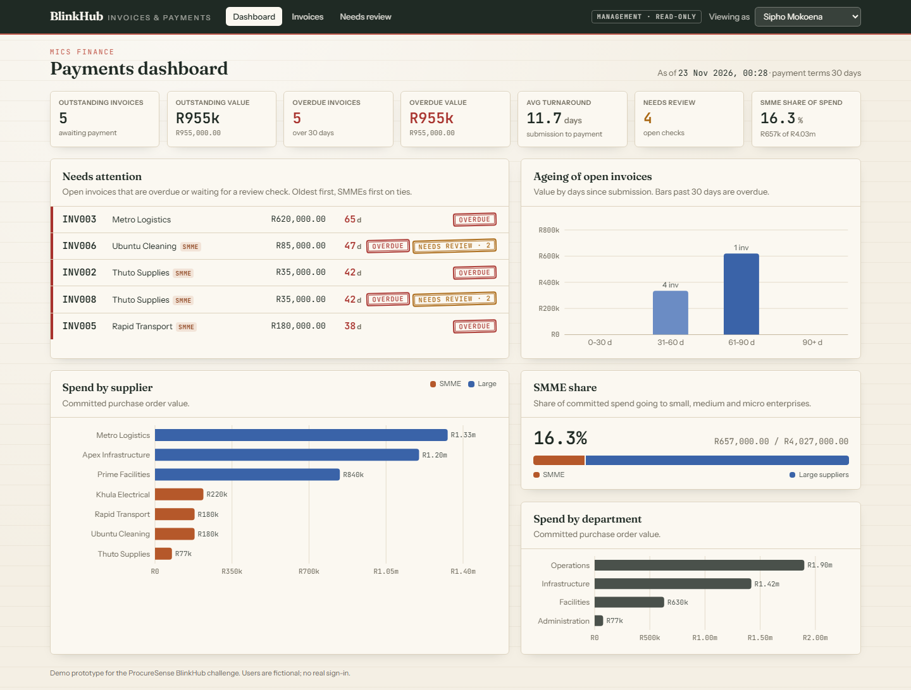
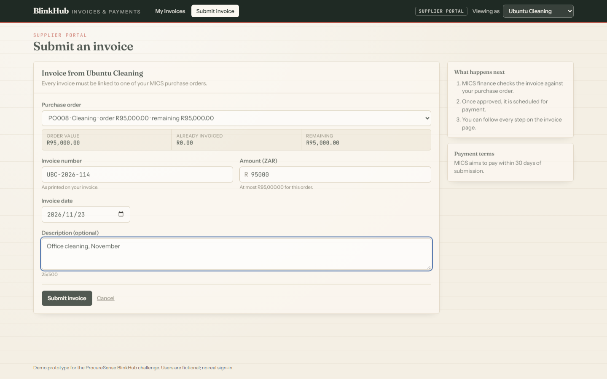
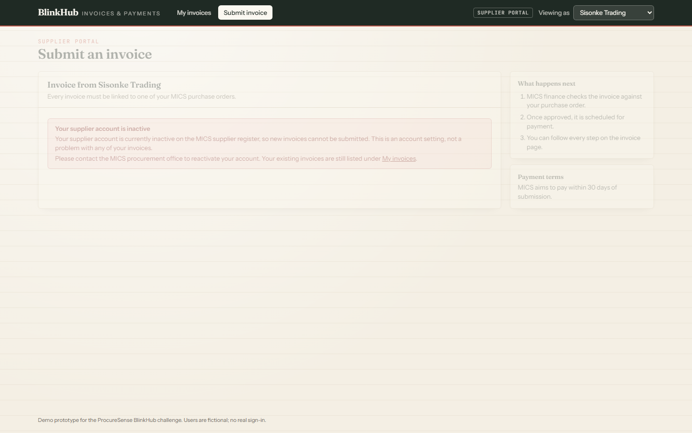
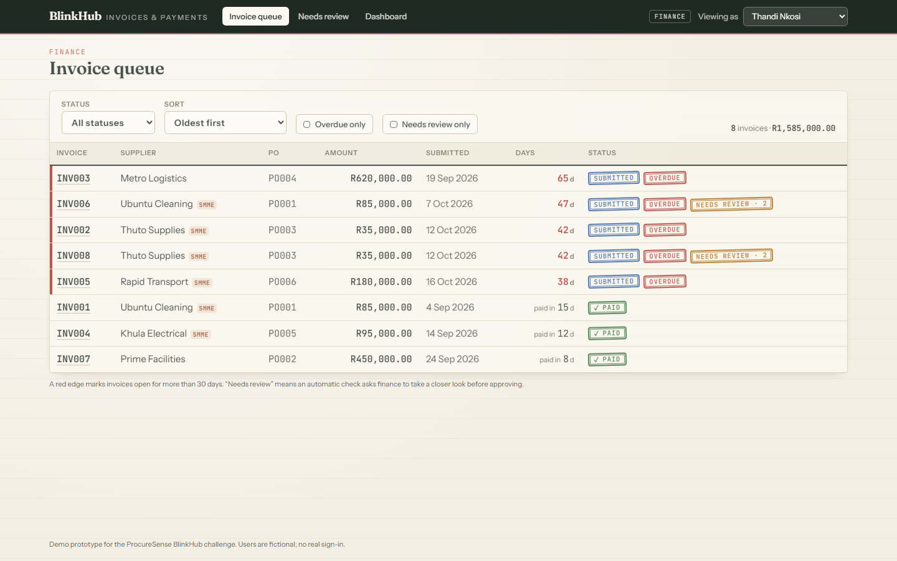
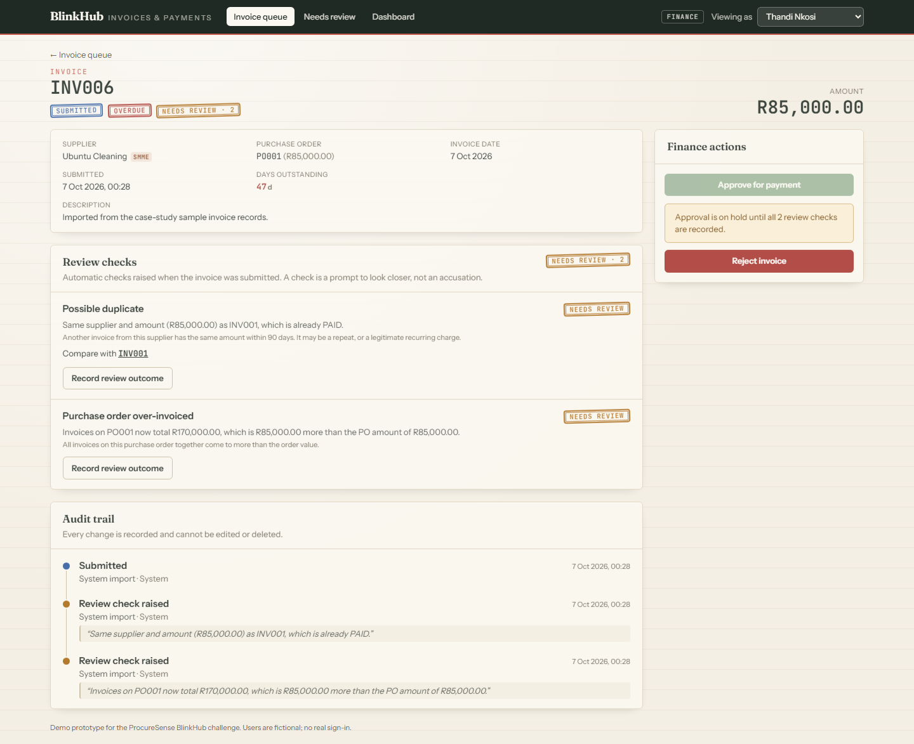
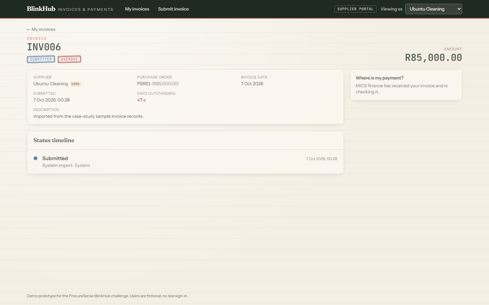
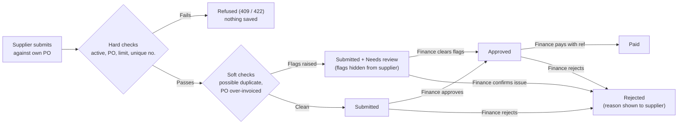

# BlinkHub Invoice & Payment Tracking


**One tracked path from supplier invoice submission to payment, with automatic checks, an uneditable audit trail, and live ageing and SMME spend visibility.**

Built for the ProcureSense **BlinkHub Procurement Innovation Challenge** (Path A: full-stack, Option 3: Invoice and Payment Tracking). The brief opens with a local cleaning company that finished its work for MICS and waited 75 days to be paid while struggling to cover staff and supplies. BlinkHub replaces scattered email inboxes and spreadsheets with a single workflow where every invoice is tied to a real purchase order, checked automatically on entry, and visible to finance, management, and the supplier.


*Management read-only dashboard (Sipho Mokoena): live ageing past 30-day terms, committed spend by supplier and department, SMME share, and the prioritised attention list.*

**Contents:** [Why this exists](#why-this-exists) | [What it does](#what-it-does) | [Case-study findings](#what-it-finds-in-the-case-study-data) | [Quick start](#quick-start-2-minutes) | [Workflow](#workflow-and-architecture) | [Verification](#how-we-know-it-works) | [Key decisions](#key-decisions) | [Assumptions & next steps](#assumptions) | [How it was built](#how-it-was-built)

---

## Why this exists

Mzansi Infrastructure and Community Services (MICS, the case study's fictional client) loses track of supplier invoices across email addresses and spreadsheets (**Problem 4: The Invoice That Never Gets Paid**). Invoices arrive without purchase order references or get submitted twice, finance staff chase approvals manually, suppliers cannot tell where their payment sits, and management has no live view of overdue bills.

This prototype targets Problem 4 first, while directly addressing **Problem 6** (catching duplicate billing and over-invoiced purchase orders before payment) and **Problem 3** (giving management live visibility of committed spend and SMME participation).

---

## What it does

Suppliers, finance officers, and managers use one portal with server-enforced role permissions (`SUPPLIER`, `FINANCE`, `MANAGER`).

### 1. Suppliers submit against real purchase orders

Every invoice must link to one of the supplier's own purchase orders, showing order value, amount already invoiced, and remaining balance up front.


*Supplier portal (Ubuntu Cleaning): submitting an invoice directly against PO008 with live remaining-balance context.*

### 2. Automatic checks: hard blocks vs "Needs review" flags

Two layers of rules run on submission in [`backend/app/rules.py`](backend/app/rules.py):

| Layer | Outcome | Rules checked |
|---|---|---|
| **Hard blocks** | **Refused** (409 / 422, nothing saved) | Missing PO; PO belongs to another supplier; supplier account is `INACTIVE`; single invoice exceeds the PO amount; exact duplicate invoice number for the same supplier (unless the earlier invoice was rejected). |
| **Soft flags ("Needs review")** | **Saved**, approval held until finance reviews each flag | `POSSIBLE_DUPLICATE` (same supplier and same amount as another non-rejected invoice within 90 days); `PO_OVER_INVOICED` (total non-rejected invoices on the PO exceed the PO value). |

Clear-cut errors are stopped at the door so bad records never enter the ledger.


*Inactive supplier guard (Sisonke Trading): blocked cleanly in the UI and enforced with `422 SUPPLIER_INACTIVE` on the backend.*

### 3. Finance works one prioritised queue and resolves review checks

Open invoices past 30 days are marked overdue and sorted **oldest first, with SMMEs first on ties** so small suppliers are not buried behind larger backlogs.


*Finance queue (Thandi Nkosi): overdue bills marked past 30 days, oldest first, with open review counts visible at a glance.*

**A flag is a question, not an accusation.** A repeated amount might be a legitimate monthly retainer or a genuine double bill. Approval stays blocked until a finance officer records an outcome (**Cleared** or **Confirmed**) with a written note, and every step writes to an insert-only audit trail.


*Finance detail view on INV006: two review checks hold approval until Thandi Nkosi records a decision, with every event logged below.*

Because flags are internal prompts rather than accusations, **suppliers never see them** (neither in the UI nor in API responses). On the exact same invoice, the supplier sees their real status and timeline without internal review notes:


*Supplier detail view on INV006 (Ubuntu Cleaning): status and timeline remain transparent while internal review checks stay hidden.*

---

## What it finds in the case-study data

Loading the case study's **fictional sample dataset** (8 suppliers, 12 purchase orders, 8 invoices) through the real submission rules surfaces these figures immediately. *(The 75-day unpaid cleaning company from the brief is the motivating story, not a row in the sample table.)*

| Metric | Finding in sample data | Why it matters |
|---|---|---|
| **Listed procurement spend** | **R4,027,000** across 12 POs | Committed PO baseline across 7 active suppliers with orders. |
| **SMME spend share** | **16.3%** (R657,000 of R4,027,000) | Three large suppliers hold 83.7%, led by Metro Logistics at R1,330,000. |
| **Open invoices** | **5 invoices, R955,000** | **All 5 are overdue** past 30-day payment terms. |
| **Longest wait** | **INV003** (Metro Logistics, R620,000, **65 days**) | Carries **no flag**: nothing about it is unusual, it is simply waiting. |
| **Open review flags** | **4 flags** across **INV006** and **INV008** | INV006 (Ubuntu Cleaning, R85,000, 47 days) matches paid INV001 on PO001; INV008 (Thuto Supplies, R35,000, 42 days) matches same-day INV002 on PO003. Each triggers `POSSIBLE_DUPLICATE` and `PO_OVER_INVOICED`. |
| **Paid turnaround** | **11.7 days** average | Mean submission-to-payment time across the 3 paid invoices (15, 12, and 8 days). |
| **Inactive supplier** | **Sisonke Trading** (`INACTIVE`) | Cannot submit new invoices until reactivated on the supplier register. |

---

## Quick start (2 minutes)

### Option A: Run locally (no Docker needed)

Requires **Python 3.12** and **Node 20+**. Commands below are for Git Bash; PowerShell equivalents are in [`backend/README.md`](backend/README.md) and [`frontend/README.md`](frontend/README.md).

```bash
# 1. Backend (terminal 1): creates and seeds a local SQLite database on first start
cd backend
python -m venv .venv
.venv/Scripts/python -m pip install -r requirements-dev.txt      # macOS/Linux: .venv/bin/python
.venv/Scripts/python -m uvicorn app.main:app --port 8000

# 2. Frontend (terminal 2)
cd frontend
npm ci
npm run dev
```

Open **http://localhost:5173** (API Swagger UI is at **http://localhost:8000/docs**).

- **Port 8000 already in use?** (Some Windows machines run a system service on port 8000.) Start the backend with `--port 8001` and the frontend with `API_PROXY_TARGET=http://localhost:8001 npm run dev`.
- **Reset to the exact case-study state** (invoice ages count from seed time; stop the backend first):
  `cd backend && .venv/Scripts/python -m app.seed --reset`

### Option B: Run with Docker (PostgreSQL)

```bash
docker compose up --build
```

Open **http://localhost:8080**. This starts PostgreSQL, the FastAPI backend, and the built React frontend behind nginx, seeded with the same sample data. Configuration variables are documented in [`.env.example`](.env.example).

### Four demo journeys to try

Use the **Viewing as** role switcher in the top-right header:

1. **Ubuntu Cleaning (supplier portal):** submit an invoice against `PO008`, then track its status on *My invoices* (and try reusing the same invoice number to see the hard block).
2. **Thandi Nkosi (Finance):** open `INV006`, inspect its two "Needs review" checks, record outcomes to clear or confirm them, then approve and mark paid (or reject with a reason).
3. **Sipho Mokoena (Management):** view the read-only dashboard: ageing buckets, spend by supplier, SMME share, and the attention list.
4. **Sisonke Trading (supplier portal):** switch to this inactive supplier to see submission refused with a clear explanation.

---

## Workflow and architecture



Every transition and flag review writes an insert-only audit event, and the dashboard aggregates live directly from the underlying tables. For the full component diagram, submission sequence diagram, and database ERD, see [`docs/architecture.md`](docs/architecture.md).

---

## How we know it works

A single script runs every static check, unit test, API test, production build, and real-browser journey:

```bash
cd e2e && npm ci && npx playwright install chromium && cd ..   # once, for the browser tests
scripts/verify.sh            # lint, types, rule tests, API tests, frontend build, browser journeys
scripts/verify.sh --fast     # everything except the browser journeys
```

| Verification layer | Tool / location | Scope |
|---|---|---|
| Backend lint & format | `ruff` | Lint rules and formatting checks across `backend/` |
| Backend rule + API tests | `pytest` (`backend/tests/test_rules.py`, `test_api.py`) | **171 backend tests**: pure rule edge cases without a DB, plus every API error code, role guard, flag redaction for suppliers, inactive supplier block, and exact case-study dashboard totals |
| Frontend static & build | `tsc --noEmit`, `eslint`, `vite build` | Strict TypeScript type-checking, lint, and production bundle |
| End-to-end browser tests | Playwright (`e2e/`) | **5 Playwright browser journeys** exercising manager dashboard, supplier submit + duplicate refusal, inactive supplier block, finance flag review + approve + pay, and finance rejection against the live backend |
| PostgreSQL container stack | `docker compose up --build` | Verified on a cloud machine running PostgreSQL, FastAPI, and nginx |

---

## Key decisions

- **Money as `Decimal` / `NUMERIC(14,2)`:** Never floating-point numbers, so finance totals and PO balances reconcile to the cent.
- **Rules as pure functions:** Every business rule lives in [`backend/app/rules.py`](backend/app/rules.py) with no database or HTTP dependency. Unit tests run in milliseconds, and seeding calls the same functions so sample flags are genuinely produced by the rules, never hard-coded.
- **Insert-only audit trail:** There is no update or delete endpoint for audit events, backed by a SQLAlchemy `before_flush` guard that blocks mutations in code.
- **Flags block approval, hidden from suppliers:** A flag pauses approval until a finance officer records a decision and note, while keeping internal review prompts out of supplier responses and audit timelines.
- **Computed, not stored ageing:** `days_outstanding`, `is_overdue`, `ageing_bucket`, PO invoiced totals, and dashboard KPIs are calculated at request time so they cannot drift out of sync with invoice rows.
- **SQLite locally, PostgreSQL in Docker:** Zero-setup local review with Python and Node alone, while Docker Compose exercises the PostgreSQL path using the same portable SQLAlchemy models.

---

## Assumptions

The sample tables gave 8 suppliers, 12 POs, and 8 invoices, but omitted PO references and dates on the invoice rows. The key assumptions (all documented in full in [`docs/data-assumptions.md`](docs/data-assumptions.md)) are:

- **PO matching (A1):** Because sample invoices lacked a PO number, each invoice was linked to the same supplier's PO with the exact same amount (`INV001` and `INV006` -> `PO001`, `INV002` and `INV008` -> `PO003`, etc.). This is deterministic, transparent, and places `INV006` and `INV008` on already-invoiced POs where the real rules flag them.
- **Status, dates, and terms (A2 to A6):** "Outstanding" loads as `SUBMITTED`; open invoice dates count backwards from `days_outstanding` at seed time; paid `days_outstanding` is read as payment turnaround (placing `INV001` before `INV006`); overdue means open more than 30 days; and spend equals committed PO value (R4,027,000).

## Limitations and next steps

This is a time-boxed prototype. Taking it to production at MICS would add:

- **Real authentication** (OIDC / Azure AD) replacing the `X-User-Id` demo role switcher, keeping the same server-side role guards.
- **Document uploads** for invoice PDFs and signed delivery notes.
- **Email and SMS notifications** for status changes, rejection reasons, and approaching 30-day deadlines.
- **Payment-system integration** to sync bank payment references automatically.
- **Separation of duties** so the officer who approves an invoice cannot also mark it paid, plus database-level immutability on audit rows and a PostgreSQL partial unique index on non-rejected invoice numbers.
- **Cloud deployment** and additional **Problem 6** rules (flagging split orders just below approval thresholds and supplier bank-detail changes before payment).

See [`docs/system-overview.md`](docs/system-overview.md#7-what-it-does-not-do-yet-and-what-comes-next) for the plain-language roadmap.

---

## Documentation and project layout

| Read this | If you want |
|---|---|
| [`docs/system-overview.md`](docs/system-overview.md) | The problem, roles, rules, and findings in plain language |
| [`docs/architecture.md`](docs/architecture.md) | Component architecture, database ERD, lifecycle diagrams, and engineering trade-offs |
| [`docs/api-contract.md`](docs/api-contract.md) | Every endpoint, payload, error code, and business rule |
| [`docs/data-assumptions.md`](docs/data-assumptions.md) | How gaps in the sample tables were filled and the expected acceptance numbers |

```text
backend/    FastAPI app: rules.py (business rules), services, routers, seed, 171 tests
frontend/   React 19 + TypeScript UI: role switcher, supplier portal, finance queue, dashboard
e2e/        5 Playwright browser journeys + screenshot capture
docs/       system overview, architecture, API contract, data assumptions, screenshots
docker/     Dockerfiles and nginx config used by docker-compose.yml
scripts/    verify.sh (one-command verification)
```

---

## How it was built

Built with AI coding agents working against a shared API contract ([`docs/api-contract.md`](docs/api-contract.md)): dedicated agents implemented the backend and frontend in parallel, and a separate agent reviewed the code independently against the contract and data assumptions. Every business rule lives in one readable module ([`backend/app/rules.py`](backend/app/rules.py)) with plain-English docstrings so the author can walk through and defend every rule and edge case.
