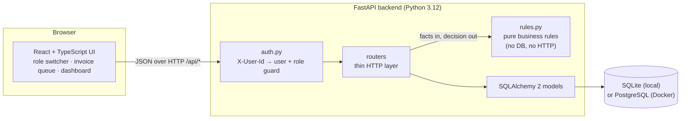
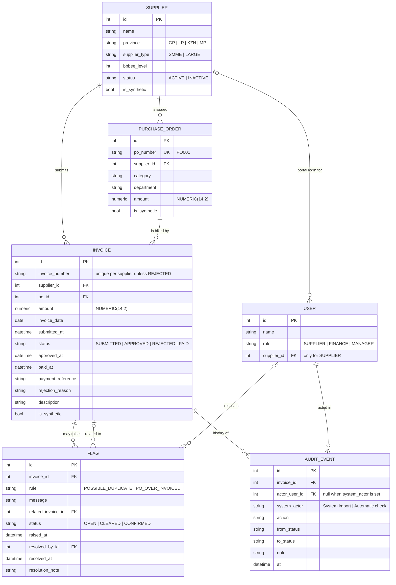
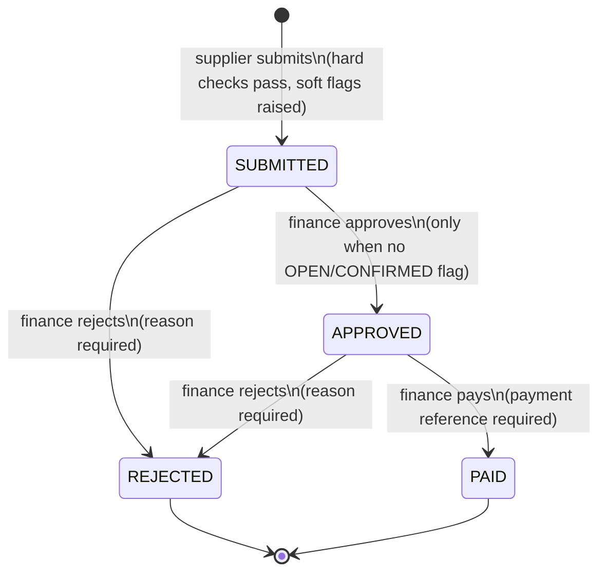
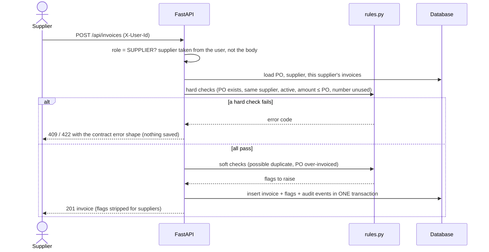

# Architecture

Technical companion to [`system-overview.md`](system-overview.md). The API contract in
[`api-contract.md`](api-contract.md) is the source of truth for every endpoint and payload;
this page explains how the pieces fit and why they were built this way.

## 1. System at a glance

- The **frontend** never decides anything that matters. It hides buttons a role cannot use, but the
  backend re-checks every permission and rule on every request.
- The **routers** load data, call a rule, and save the result. They contain no business logic.
- **`rules.py`** holds every business rule as a pure function: it receives plain values (amounts,
  dates, statuses, lists of other invoices) and returns a decision. That is why the rules can be unit
  tested in milliseconds without a database, and why each one can be read and defended on its own.
- `DATABASE_URL` picks the database. The same code runs on SQLite for zero-setup local use and tests,
  and on PostgreSQL in Docker Compose.

## 2. Database (ERD)

Not stored on purpose: **days outstanding, overdue, ageing bucket, PO invoiced amount, dashboard totals**.
They are calculated from the rows above at request time, so they can never go stale or disagree with
the underlying invoices.

## 3. An invoice's lifecycle

## 4. What happens when a supplier submits an invoice

## 5. Key engineering decisions

| Decision | Why | Trade-off |
|---|---|---|
| **Money as `Decimal` / `NUMERIC(14,2)`** | Floats cannot represent most cents exactly (0.1 + 0.2 ≠ 0.3). Finance totals must reconcile to the cent. | JSON still carries numbers, so the API converts at the edge. |
| **Business rules as pure functions in one module** | One place to read, test and defend every rule. Tests run without a database. Seeding uses the same functions, so seeded flags are produced by the real rules, not typed in. | Routers must gather the facts a rule needs before calling it. |
| **Insert-only audit trail** | Accountability: who did what, when and why. There is no update or delete path in the code, so history cannot be quietly rewritten. | A production system would also enforce this in the database (revoked UPDATE/DELETE rights or triggers). |
| **Flags, not verdicts** | The brief treats an unusual invoice as a risk indicator, not an accusation. Flags block approval until a person reviews them, and suppliers never see them. | A human must review every flag; with real volumes this needs a triage queue and SLAs. |
| **Hard blocks vs soft flags** | Clear-cut problems (wrong PO, inactive supplier, reused number) are refused at the door. Judgement calls (same amount twice) are accepted but held for review, so a legitimate invoice is never lost. | Thresholds such as the 90-day duplicate window are configurable guesses until real data is available. |
| **Derived values computed, not stored** | Overdue status changes every day by itself; storing it would need a scheduled job and could drift. | Slightly more work per request; trivial at this scale. |
| **Demo role switcher (`X-User-Id`)** | Real authentication is out of scope for a one-day prototype, but role checks are real and enforced server side. | Anyone can pick any user. Next step: OIDC/Azure AD login, same role guards. |
| **SQLite locally, PostgreSQL in Compose** | A reviewer can run it with Python and Node only. Portable SQLAlchemy types keep both paths identical. | SQLite is not used in production; Compose is the production-like path. |

## 6. Verification layers

| Layer | Tool | What it proves |
|---|---|---|
| Static checks | `ruff` (backend), `tsc --noEmit` + `eslint` (frontend) | Code style and type errors caught before running. |
| Rule unit tests | `pytest` on `rules.py` | Each business rule and its edge cases (30 vs 31 days, one cent over the PO, resubmit after rejection). |
| API + access tests | `pytest` + FastAPI `TestClient` | Error codes, role guards, suppliers never see flags, inactive supplier blocked, dashboard reproduces the case-study numbers exactly. |
| End-to-end | Playwright | The live-demo journeys work in a real browser against the real backend. |
| Independent review | A second agent | Code checked against `api-contract.md` and `data-assumptions.md` by a reviewer that did not write it. |

`scripts/verify.sh` runs the static checks and test layers in one command.
